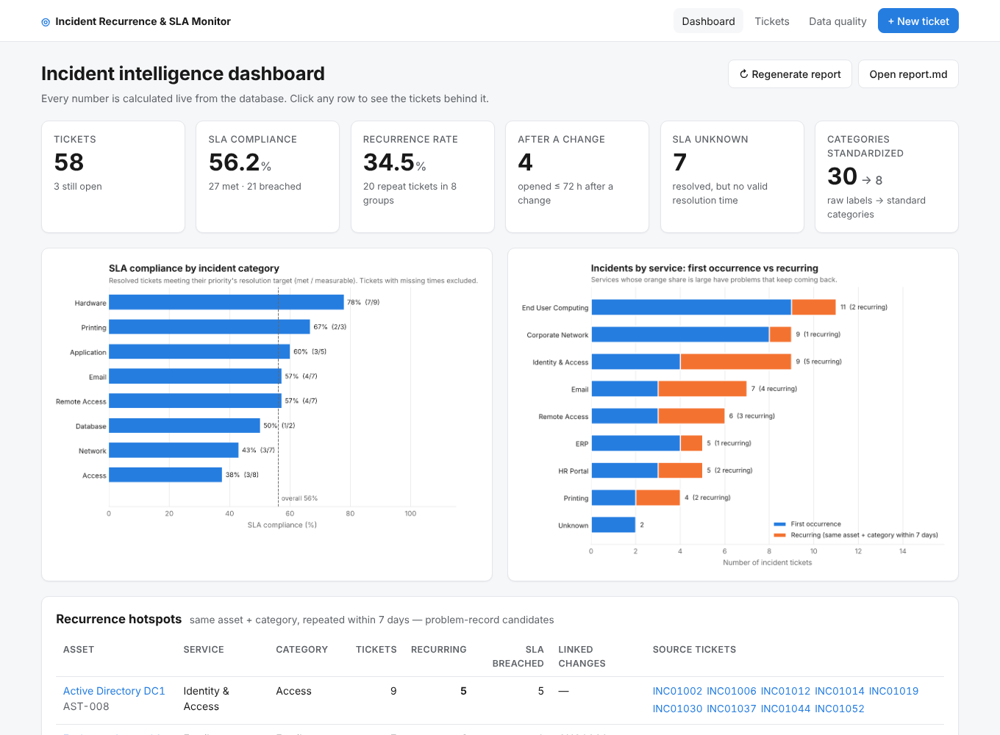
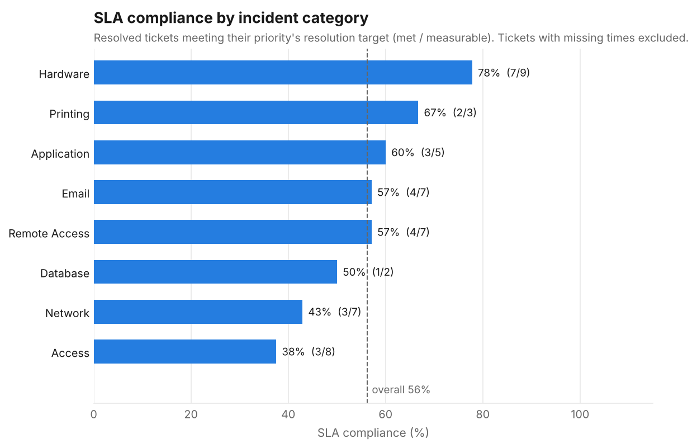
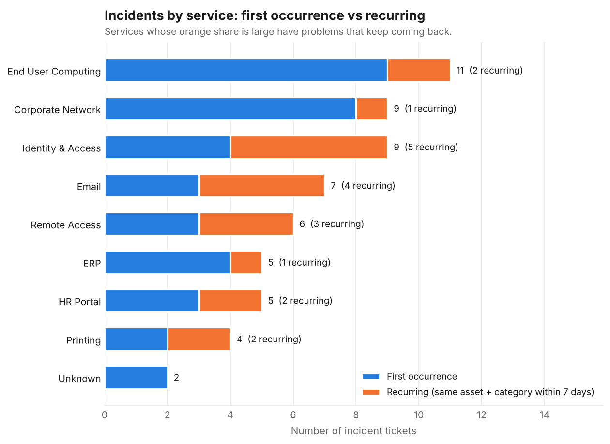

# IT Incident Recurrence & SLA Monitor

A small, beginner-friendly **incident intelligence dashboard**. It takes messy IT
service-management data (incident tickets, asset inventory, SLA targets and change
records), **cleans and standardizes it**, stores it in a **SQLite database**, and
serves a **web app** where you can add, view, edit and delete tickets and see
SLA compliance, recurring problems and asset/service patterns. Every summary links
back to the source tickets.



---

## Run it: one command

You need **Python 3.9 or newer**. Nothing else needs to be installed first.

```bash
python run.py
```

(On macOS/Linux you may need `python3 run.py`.)

On the first run this creates a private virtual environment (`.venv/`), installs the
packages from `requirements.txt`, runs the data pipeline, and opens
**http://127.0.0.1:5000** in your browser. Later runs start in a few seconds.
Press **Ctrl+C** to stop.

| Option | What it does |
| --- | --- |
| `python run.py --reset` | Rebuild the database from the raw files (removes edits made in the app) |
| `python run.py --no-server` | Run the pipeline only (writes cleaned data, charts and report), then exit |
| `python run.py --test` | Run the 31 automated tests |
| `python run.py --port 8080` | Use a different port |
| `python run.py --no-browser` | Don't open a browser tab |

---

## What you get (submission files)

| Deliverable | Location |
| --- | --- |
| Raw input data (3 CSV files + saved mock API response) | `data/raw/` |
| **Cleaned data** (one file per source) | `data/processed/cleaned_*.csv` |
| **Combined dataset** (tickets + asset + service + SLA + recurrence + change link) | `data/processed/incidents_combined.csv` |
| Data-quality log (every problem found and the fix applied) | `outputs/data_quality_log.csv` |
| **Report**: steps, findings and summary tables | `outputs/report.md` |
| **Labelled charts** | `outputs/charts/sla_compliance_by_category.png`, `outputs/charts/incidents_by_service.png` |
| Summary tables as CSV | `outputs/summary_*.csv` |
| Database-backed web app | `src/incident_monitor/` (database file: `data/incident_monitor.db`) |

The outputs in the repository were produced by `python run.py`. To regenerate them, run
the command again or click **Regenerate report** on the dashboard.

---

## The data

Small, self-created files (made reproducibly by `scripts/generate_sample_data.py`), with
problems planted on purpose so the cleaning step has something to find.

| File | Rows | Contents | Planted problems |
| --- | --- | --- | --- |
| `incidents.csv` | 63 | ticket, open/resolve time, status, priority, category, description, asset, assignment group, assignee, reassignment count | 30 spellings of 8 categories, blank/"Misc" categories, missing and impossible resolution times, a 31 September date, duplicate rows and ids, priorities such as "High" or "2", badly formatted or unknown asset ids, a negative count |
| `assets.csv` | 13 | asset id, name, type, **service**, location, criticality, owner team | duplicate asset, missing location, "HIGH" or "low " criticality |
| `sla_targets.csv` | 5 | resolution target in hours per priority (P1 4 h, P2 8 h, P3 24 h, P4 72 h) | duplicate row |
| `mock_api/change_records_response.json` | 10 | **saved response from a change-management API**, so the project runs offline | duplicate record, missing implementation time, a cancelled change |

---

## How it works: the steps

```
data/raw/*.csv + mock API JSON
        │  1. load        cleaning.py   (every column read as text)
        ▼
  checks & standardization  ──► outputs/data_quality_log.csv
        │  2. clean
        ▼
  data/processed/cleaned_*.csv + incidents_combined.csv
        │  3. store       database.py   (SQLite, 4 tables)
        ▼
  data/incident_monitor.db  ◄──── add / view / edit / delete in the web app
        │  4. analyse     analysis.py   (recalculated live on every page load)
        ▼
  dashboard (app.py) + outputs/report.md + outputs/charts/*.png   (reporting.py)
```

### 1–2. Checks and cleaning (`src/incident_monitor/cleaning.py`)

| Check | Rule | Action |
| --- | --- | --- |
| Duplicates | exact duplicate rows | removed |
| | same ticket id, different content | keep the **most complete** record |
| Missing values | blank category | **inferred from the description** (for example "VPN…" becomes Remote Access) |
| | blank priority | default P3, flagged |
| | resolved ticket with no resolution time | kept, SLA shown as **Unknown** (not guessed) |
| | missing asset or location | kept, shown as "Unknown" |
| Invalid entries | impossible date (2026‑09‑31) | row removed, because SLA can't be measured without an open time |
| | resolved before opened | resolution time cleared, SLA Unknown |
| | asset id not in inventory | kept, flagged |
| | negative reassignment count | set to blank |
| Standardization | 30 raw category labels → **8 standard categories** (dictionary in `config.py`) | e.g. `NW`, `LAN/WAN`, `Connectivity` → Network; `E-mail`, `Outlook`, `Mail` → Email |
| | priorities, statuses, asset ids, criticality | e.g. `Critical`/`1` → P1, `resolved` → Resolved, `ast-004 ` → AST-004 |

Each ticket keeps its original label (`category_raw`), how it was mapped
(`category_method`) and any `data_quality_flags`, so every change can be traced.

### 3. Database and CRUD (`database.py`, `app.py`)

SQLite tables: `incidents`, `assets`, `sla_targets`, `changes`, with primary keys and
CHECK constraints. The app supports:

- **Create**: `/tickets/new`. The same cleaning rules run on input, so typing "E-mail" stores "Email" and the app tells you.
- **Read**: `/tickets` (filter by category, priority, service, asset, SLA status, recurring) and `/tickets/<id>`
- **Update**: `/tickets/<id>/edit`, with validation (for example, a resolution time can't be before the open time)
- **Delete**: the button on the ticket page, after a confirmation prompt

Only facts are stored. SLA status, recurrence and change links are **recalculated
from the database on every request**, so the dashboard is never out of date after an edit.

### 4. Analysis (`analysis.py`)

| Measure | Definition |
| --- | --- |
| **SLA status** | Met or Breached: resolution hours ≤ or > the priority target. Unknown: no valid resolution time. Open: within SLA or breached, measured against the current time |
| **SLA compliance %** | Met ÷ (Met + Breached). Unknown and open tickets are excluded from the calculation |
| **Recurring ticket** | an earlier ticket exists on the **same asset** with the **same standardized category** within **7 days** |
| **Recurrence hotspot** | an asset + category group containing recurring tickets (a problem-record candidate) |
| **Change-related** | opened ≤ 72 h after an implemented change on the same asset |
| **Asset/service patterns** | tickets, recurrence, compliance, average resolution time and reassignments per asset and per service |

The windows (7 days, 72 hours) are set in `src/incident_monitor/config.py`.

---

## Findings (from the included data)

| Measure | Value |
| --- | --- |
| Tickets after cleaning | 58 (63 raw rows) |
| SLA compliance | **56.2 %** (27 met, 21 breached, 7 unknown) |
| Recurring tickets | **20 (34.5 %)** in 8 asset/category groups |
| Tickets opened shortly after a change | 4 |
| Category labels | 30 raw → 8 standard |

1. **SLA performance is weak and uneven.** Hardware meets 78 % of targets, while Access
   (38 %) and Network (43 %) are below half. All four P1 tickets missed the 4-hour target.
2. **A few assets cause most repeat work.** The top hotspots are *Active Directory DC1 –
   Access* (9 tickets, 5 repeats), *Exchange Server 01 – Email* (7 tickets, 4 repeats)
   and *VPN Gateway – Remote Access* (6 tickets, 3 repeats). Each one should become a problem record.
3. **The VPN problems follow changes.** VPN tickets were opened 3 h after firmware
   upgrade CHG2001 and 4 h after emergency rollback CHG2008. Exchange issues followed
   CHG2002. These changes should go to change-failure review.
4. **Identity & Access is the weakest service**: 37.5 % compliance, and 5 of its
   9 tickets are repeats.
5. **Data quality affects the numbers.** 7 resolved tickets have no usable resolution
   time. Without standardization, the 9 Network tickets would have been split across
   6 different labels, so no per-category summary would be correct.

The full write-up, with all summary tables and the source ticket ids, is in
[`outputs/report.md`](outputs/report.md).

| | |
| --- | --- |
|  |  |

---

## Project structure

```
├── run.py                       ← the one command (sets up .venv, pipeline, web app)
├── requirements.txt             flask, pandas, matplotlib, pytest
├── data/
│   ├── raw/                     3 CSV files + mock_api/change_records_response.json
│   └── processed/               cleaned & combined CSVs (generated)
├── outputs/                     report.md, charts/, data_quality_log.csv, summary_*.csv
├── scripts/generate_sample_data.py   recreates data/raw reproducibly (seeded)
├── src/incident_monitor/
│   ├── config.py                paths, windows, category dictionary
│   ├── cleaning.py              checks, standardization, quality log
│   ├── database.py              SQLite schema, seeding, validation, CRUD
│   ├── analysis.py              SLA, recurrence, change links, summaries
│   ├── reporting.py             matplotlib charts + Markdown report
│   ├── pipeline.py              runs steps 1–4 in order
│   ├── app.py                   Flask routes
│   ├── templates/  static/      HTML pages and CSS
└── tests/                       cleaning, analysis and web-app/CRUD tests
```

## Limitations and next steps

- The dataset is small and synthetic (2 months, 12 assets), so treat the patterns as illustrative.
- Recurrence uses a simple, explainable rule. A next step would be matching on similar description text.
- A change link shows that a ticket came soon after a change. It suggests a cause but does not prove one.
- The app uses Flask's development server for local use. For a shared deployment, run it behind a production WSGI server such as gunicorn, and replace the fixed `SECRET_KEY`.
