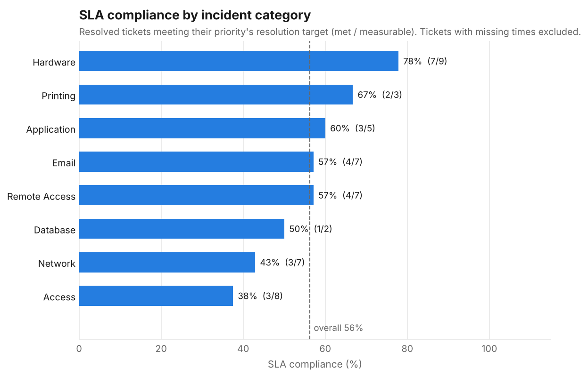
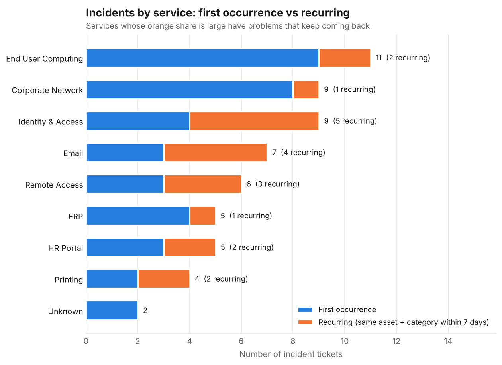

# IT Incident Recurrence & SLA Monitor – Report

_Generated 2026-11-26 08:29 from the application database._

## 1. Steps performed

1. **Load** three prepared CSV files (`incidents.csv`, `assets.csv`, `sla_targets.csv`) and a saved mock API response for change records (`mock_api/change_records_response.json`).
2. **Check & clean**: remove exact duplicates and duplicate ticket ids (keep the most complete), reject impossible dates, clear resolution times earlier than the open time, flag missing resolution times, standardize categories/priorities/statuses/asset ids, check asset ids against the inventory. Every finding is written to `outputs/data_quality_log.csv`.
3. **Combine & save**: cleaned tables and the combined, enriched incident table are saved to `data/processed/`, then loaded into the SQLite database used by the app.
4. **Analyse**: SLA status per ticket against its priority target, recurrence (same asset + standardized category within 7 days), link to changes on the same asset within 72 h, and asset/service comparisons.
5. **Report**: this file, two labelled charts in `outputs/charts/`, summary CSVs in `outputs/`.

### Row counts

| dataset | raw rows | clean rows |
| --- | --- | --- |
| incidents | 63 | 58 |
| assets | 13 | 12 |
| sla_targets | 5 | 4 |
| changes | 10 | 9 |

### Data-quality findings

| dataset | check | findings |
| --- | --- | --- |
| assets | standardization | 2 |
| assets | duplicate | 1 |
| assets | missing value | 1 |
| changes | duplicate | 1 |
| changes | missing value | 1 |
| incidents | standardization | 82 |
| incidents | missing value | 10 |
| incidents | invalid value | 5 |
| incidents | duplicate | 4 |
| sla_targets | duplicate | 1 |

Examples of non-trivial fixes:

| dataset | record_id | issue | action |
| --- | --- | --- | --- |
| assets | AST-012 | Missing location | Filled with 'Unknown' |
| assets | AST-004 | Exact duplicate row | Removed duplicate copy |
| incidents | INC01003 | Exact duplicate row | Removed duplicate copy |
| incidents | INC01019 | Exact duplicate row | Removed duplicate copy |
| incidents | INC01042 | Exact duplicate row | Removed duplicate copy |
| incidents | INC01025 | Unparseable opened_at '2026-09-31 10:00' | Row removed (cannot measure SLA without an open time) |
| incidents | INC01012 | Ticket id appears more than once with different values | Kept the most complete record |
| incidents | INC01021 | Missing/unknown priority '' | Defaulted to P3 |
| incidents | INC01016 | Blank/unknown category '' | Inferred 'Email' from description |
| incidents | INC01034 | Blank/unknown category 'Misc' | Inferred 'Network' from description |
| incidents | INC01046 | Blank/unknown category 'Other' | Inferred 'Email' from description |
| incidents | INC01031 | Asset 'AST-099' not in inventory | Kept; service shown as 'Unknown' |

## 2. Key results

| Measure | Value |
| --- | --- |
| Tickets analysed | 58 |
| SLA compliance (met / measurable) | 56.2% |
| SLA breached (resolved) | 21 |
| SLA unknown (missing resolution time) | 7 |
| Open tickets already past target | 3 |
| Recurring tickets | 20 (34.5%) |
| Asset/category groups with recurrence | 8 |
| Tickets linked to a recent change | 4 |
| Average resolution time (h) | 21.3 |
| Raw category labels → standard categories | 30 → 8 |

### Findings

- **SLA:** overall compliance is **56.2%** (27 met, 21 breached). *Access* is weakest at 37.5%, *Hardware* strongest at 77.8%.
- **Recurrence:** 20 of 58 tickets (34.5%) repeat an earlier fault on the same asset within 7 days. The biggest hotspot is *Active Directory DC1 – Access* (9 tickets: INC01002, INC01006, INC01012, INC01014, INC01019, INC01030, INC01037, INC01044, INC01052).
- **Changes:** 4 tickets were opened within 72 h of a change on the same asset (CHG2001, CHG2002, CHG2008) – candidates for change-failure review.
- **Services:** *Identity & Access* has the lowest compliance (37.5% across 9 tickets, 5 recurring).
- **Data quality:** 30 different raw category labels were standardized into 8 categories; 7 resolved tickets have no usable resolution time and are reported as 'Unknown' rather than guessed.

## 3. Charts

## 4. Summary tables (each links back to source ticket ids)

### SLA by category

| category | tickets | met | breached | unknown | open | compliance_pct | avg_resolution_hours | recurring |
| --- | --- | --- | --- | --- | --- | --- | --- | --- |
| Hardware | 12 | 7 | 2 | 2 | 1 | 77.8 | 17.9 | 2 |
| Access | 9 | 3 | 5 | 1 | 0 | 37.5 | 29.4 | 5 |
| Network | 9 | 3 | 4 | 2 | 0 | 42.9 | 16.4 | 1 |
| Application | 7 | 3 | 2 | 1 | 1 | 60.0 | 11.0 | 2 |
| Remote Access | 7 | 4 | 3 | 0 | 0 | 57.1 | 8.1 | 3 |
| Email | 7 | 4 | 3 | 0 | 0 | 57.1 | 21.8 | 4 |
| Printing | 4 | 2 | 1 | 1 | 0 | 66.7 | 47.8 | 2 |
| Database | 3 | 1 | 1 | 0 | 1 | 50.0 | 50.7 | 1 |

### SLA by priority

| priority | tickets | met | breached | unknown | open | compliance_pct | avg_resolution_hours | recurring |
| --- | --- | --- | --- | --- | --- | --- | --- | --- |
| P1 | 4 | 0 | 4 | 0 | 0 | 0.0 | 6.1 | 0 |
| P2 | 16 | 7 | 6 | 2 | 1 | 53.8 | 7.7 | 6 |
| P3 | 30 | 17 | 8 | 4 | 1 | 68.0 | 20.6 | 10 |
| P4 | 8 | 3 | 3 | 1 | 1 | 50.0 | 63.7 | 4 |

### Recurrence hotspots (problem-record candidates)

| asset_name | category | tickets | recurring | breached | linked_changes | ticket_ids |
| --- | --- | --- | --- | --- | --- | --- |
| Active Directory DC1 | Access | 9 | 5 | 5 |  | INC01002, INC01006, INC01012, INC01014, INC01019, INC01030, INC01037, INC01044, INC01052 |
| Exchange Server 01 | Email | 7 | 4 | 3 | CHG2002 | INC01004, INC01009, INC01016, INC01023, INC01035, INC01046, INC01047 |
| VPN Gateway | Remote Access | 6 | 3 | 3 | CHG2001, CHG2008 | INC01020, INC01021, INC01028, INC01033, INC01039, INC01042 |
| Laptop Pool - Finance | Hardware | 7 | 2 | 3 |  | INC01005, INC01024, INC01026, INC01036, INC01043, INC01049, INC01058 |
| HR Portal Web Server | Application | 5 | 2 | 2 |  | INC01011, INC01041, INC01050, INC01054, INC01055 |
| Printer Floor 2 | Printing | 4 | 2 | 1 |  | INC01008, INC01017, INC01027, INC01040 |
| SQL Cluster Node 1 | Database | 3 | 1 | 2 |  | INC01022, INC01053, INC01057 |
| WiFi Controller | Network | 3 | 1 | 2 |  | INC01010, INC01013, INC01034 |

### Service comparison

| service | tickets | met | breached | unknown | open | compliance_pct | avg_resolution_hours | recurring |
| --- | --- | --- | --- | --- | --- | --- | --- | --- |
| End User Computing | 11 | 6 | 2 | 2 | 1 | 75.0 | 18.4 | 2 |
| Corporate Network | 9 | 3 | 4 | 2 | 0 | 42.9 | 16.4 | 1 |
| Identity & Access | 9 | 3 | 5 | 1 | 0 | 37.5 | 29.4 | 5 |
| Email | 7 | 4 | 3 | 0 | 0 | 57.1 | 21.8 | 4 |
| Remote Access | 6 | 3 | 3 | 0 | 0 | 50.0 | 7.2 | 3 |
| HR Portal | 5 | 2 | 2 | 1 | 0 | 50.0 | 12.6 | 2 |
| ERP | 5 | 2 | 1 | 0 | 2 | 66.7 | 35.3 | 1 |
| Printing | 4 | 2 | 1 | 1 | 0 | 66.7 | 47.8 | 2 |
| Unknown | 2 | 2 | 0 | 0 | 0 | 100.0 | 14.0 | 0 |

### Asset comparison

| asset_id | asset_name | asset_type | service | tickets | recurring | compliance_pct | avg_reassignments | change_related |
| --- | --- | --- | --- | --- | --- | --- | --- | --- |
| AST-008 | Active Directory DC1 | Server | Identity & Access | 9 | 5 | 37.5 | 1.0 | 0 |
| AST-004 | Exchange Server 01 | Server | Email | 7 | 4 | 57.1 | 0.14 | 1 |
| AST-009 | Laptop Pool - Finance | Laptop | End User Computing | 7 | 2 | 60.0 | 0.43 | 0 |
| AST-003 | VPN Gateway | Firewall/VPN | Remote Access | 6 | 3 | 50.0 | 1.0 | 3 |
| AST-007 | HR Portal Web Server | Server | HR Portal | 5 | 2 | 50.0 | 1.0 | 0 |
| AST-001 | Core Switch A | Network Switch | Corporate Network | 4 | 0 | 75.0 | 0.75 | 0 |
| AST-011 | Printer Floor 2 | Printer | Printing | 4 | 2 | 66.7 | 0.25 | 0 |
| AST-010 | Laptop Pool - Sales | Laptop | End User Computing | 4 | 0 | 100.0 | 0.75 | 0 |
| AST-012 | WiFi Controller | Network Controller | Corporate Network | 3 | 1 | 0.0 | 0.67 | 0 |
| AST-005 | SQL Cluster Node 1 | Database Server | ERP | 3 | 1 | 50.0 | 0.33 | 0 |
| AST-002 | Core Switch B | Network Switch | Corporate Network | 2 | 0 | 0.0 | 1.5 | 0 |
| AST-006 | ERP App Server | Server | ERP | 2 | 0 | 100.0 | 0.5 | 0 |

### Tickets opened shortly after a change

| ticket_id | opened_at | asset_id | asset_name | category | linked_change_id | hours_after_change | sla_status |
| --- | --- | --- | --- | --- | --- | --- | --- |
| INC01004 | 2026-09-06 | AST-004 | Exchange Server 01 | Email | CHG2002 | 12.0 | Met |
| INC01020 | 2026-09-15 | AST-003 | VPN Gateway | Remote Access | CHG2001 | 3.0 | Breached |
| INC01021 | 2026-09-16 | AST-003 | VPN Gateway | Remote Access | CHG2001 | 27.0 | Met |
| INC01042 | 2026-10-11 | AST-003 | VPN Gateway | Remote Access | CHG2008 | 4.0 | Breached |

### Category standardization map

| category | category_raw | category_method | tickets |
| --- | --- | --- | --- |
| Access | Login / Access | synonym | 3 |
| Access | Access | exact | 2 |
| Access | Password Reset | synonym | 2 |
| Access | Account Access | synonym | 1 |
| Access | IAM | synonym | 1 |
| Application | SW | synonym | 4 |
| Application | Application | exact | 2 |
| Application | App | synonym | 1 |
| Database | SQL | synonym | 2 |
| Database | Database | exact | 1 |
| Email | E-mail | synonym | 2 |
| Email | Mail | synonym | 2 |
| Email | (blank) | inferred | 1 |
| Email | Other | inferred | 1 |
| Email | Outlook | synonym | 1 |
| Hardware | HW | synonym | 5 |
| Hardware | Laptop Hardware | synonym | 3 |
| Hardware | hardware | synonym | 3 |
| Hardware | Hardware | exact | 1 |
| Network | Network | exact | 4 |
| Network | Connectivity | synonym | 1 |
| Network | LAN/WAN | synonym | 1 |
| Network | Misc | inferred | 1 |
| Network | NW | synonym | 1 |
| Network | Networking | synonym | 1 |
| Printing | Printer | synonym | 2 |
| Printing | Printing | exact | 2 |
| Remote Access | Remote access | synonym | 5 |
| Remote Access | Remote Access | exact | 1 |
| Remote Access | vpn issue | synonym | 1 |

## 5. Limitations

- Small, self-created dataset (two months, 12 assets) – patterns are illustrative.
- Recurrence uses a simple rule (same asset + category within a time window); it does not compare description text.
- Change links show timing only – they suggest, not prove, cause.
- Missing resolution times are not imputed, so compliance is computed only on measurable tickets.
